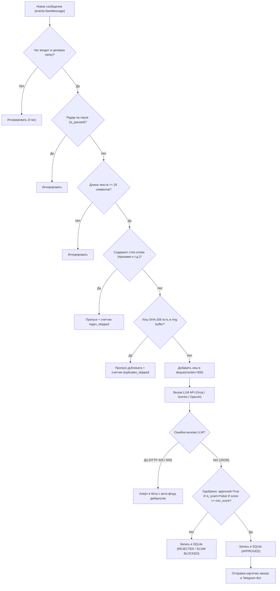
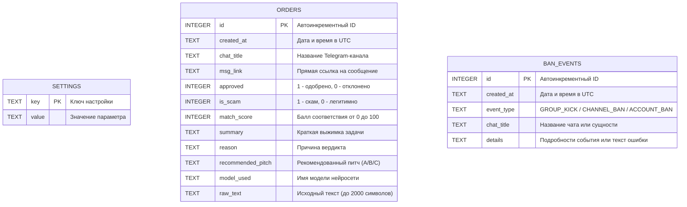

# 🎯 Venator — AI-Powered Telegram Order & Vacancy Radar

**Venator** — это автономная, саморазмещаемая (self-hosted) платформа мониторинга Telegram-каналов и интеллектуальный радар заказов и вакансий в реальном времени. Система непрерывно анализирует поток сообщений из специализированных Telegram-папок с помощью языковых моделей (LLM: Groq, Google Gemini, OpenRouter, OpenAI, локальная Ollama), мгновенно отсекает скам, спам и неподходящие стеки технологий, а подходящие предложения с рейтингом соответствия от 70% моментально пересылает в личные сообщения Telegram с готовой выжимкой задачи и рекомендацией по питчу.

Платформа спроектирована по принципу **Zero-Polling & Zero-Drain**: она работает на чистых сокетах Linux (`epoll`), не расходует батарею мобильного устройства или ресурсы VPS, кэширует настройки в оперативной памяти (RAM) для исключения лишних дисковых операций и автоматически засыпает, когда вкладка веб-панели управления не активна.

🌐 **Публичный веб-центр управления:** `https://venator.andatra.space`  
💻 **Официальный репозиторий:** `https://github.com/Qoziwe/Venator`  
👨‍💻 **Автор и разработчик:** [Lekim Zlavdinov (@Qoziwe)](https://github.com/Qoziwe)

---

## 📑 Содержание

1. [Ключевые возможности и архитектурные принципы](#-ключевые-возможности-и-архитектурные-принципы)
2. [Архитектура системы и потоки данных](#-архитектура-системы-и-потоки-данных)
3. [Технологический стек](#-технологический-стек)
4. [Многоуровневый конвейер фильтрации сообщений](#-многоуровневый-конвейер-фильтрации-сообщений)
5. [Модель анти-скама и профиль разработчика](#-модель-анти-скама-и-профиль-разработчика)
6. [Система рекомендаций питчей (Pitch A / B / C)](#-система-рекомендаций-питчей-pitch-a--b--c)
7. [Интеллектуальная синхронизация с папками Telegram](#-интеллектуальная-синхронизация-с-папками-telegram)
8. [Система веб-авторизации слушателя (QR-код и 2FA)](#-система-веб-авторизации-слушателя-qr-код-и-2fa)
9. [Система мониторинга ошибок, лимитов и банов](#-система-мониторинга-ошибок-лимитов-и-банов)
10. [Веб-панель управления (Дашборд)](#-веб-панель-управления-дашборд)
11. [Полный справочник REST API](#-полный-справочник-rest-api)
12. [Полный справочник по исходному коду (Каждая функция и модуль)](#-полный-справочник-по-исходному-коду)
    - [Модуль `app.py`](#модуль-apppy)
    - [Модуль `database.py`](#модуль-databasepy)
    - [Модуль `monitor.py`](#модуль-monitorpy)
    - [Шаблоны интерфейса (`templates/login.html`, `templates/dashboard.html`)](#шаблоны-интерфейса)
13. [Схема и структура базы данных SQLite](#-схема-и-структура-базы-данных-sqlite)
14. [Конфигурация переменных окружения (`.env`)](#-конфигурация-переменных-окружения-env)
15. [Каталог пресетов AI-провайдеров и моделей](#-каталог-пресетов-ai-провайдеров-и-моделей)
16. [Инструкция по установке и быстрому старту](#-инструкция-по-установке-и-быстрому-старту)
    - [Вариант A: Локальный запуск (Linux / macOS / Windows WSL)](#вариант-a-локальный-запуск-linux--macos--windows-wsl)
    - [Вариант B: Развертывание 24/7 на Android (Termux + Runit)](#вариант-b-развертывание-247-на-android-termux--runit)
    - [Настройка туннеля Cloudflare Zero Trust](#настройка-туннеля-cloudflare-zero-trust)
17. [Руководство по эксплуатации, бэкапам и устранению неполадок](#-руководство-по-эксплуатации-бэкапам-и-устранению-неполадок)
18. [Лицензия](#-лицензия)

---

## ✨ Ключевые возможности и архитектурные принципы

- **Событийный движок Zero-Polling:** Пассивное ожидание событий через MTProto-сокеты Telethon (`epoll`). Отсутствуют циклы периодического опроса (polling) и парсинга страниц, что сводит потребление CPU к нулю в режиме ожидания.
- **Динамическая синхронизация папок диалогов:** Отслеживание строго заданной папки (например, `Фриланс`) или ссылки на общую папку (`https://t.me/addlist/...`). При добавлении нового канала в Telegram-клиенте Venator подхватывает его на лету без перезапуска сервиса благодаря обработке событий `UpdateDialogFilter`.
- **Строгий анти-скам и стек-верификатор:** Каждое валидное объявление анализируется через LLM с детерминированным строгим JSON-ответом. Автоматически блокируются финансовые пирамиды, схемы обнала/кардинга, казино, криптовалютные скамы, предложения с требованием залога/покупки курсов, бесплатная работа "за процент в будущем стартапе" и вакансии с несовместимым стеком (1С, PHP, Java/Spring, C#, .NET).
- **Дедупликация кросспостов через кольцевой буфер SHA-256:** Сообщения нормализуются (удаление URL, нормализация пробелов, приведение к нижнему регистру) и хешируются. Последние 300 хешей хранятся в кольцевом буфере `deque(maxlen=300)`. Повторные публикации одной и той же вакансии по разным каналам пропускаются за `0.01 мс` без расхода лимитов AI API.
- **Мгновенный пуш в Telegram-бот:** Уведомления с оценкой `match_score >= min_score` (по умолчанию 70%) доставляются в личный чат через нативный Bot API c цитатой поста, резюме задачи, причиной одобрения, шаблоном отклика и прямой ссылкой на исходный пост.
- **Многоуровневый мониторинг сбоев и банов:** Автоматическое обнаружение превышения лимитов токенов (`HTTP 429`), недействительных API-ключей (`HTTP 401/404/500`), исключения из групп (`events.ChatAction`) и блокировок каналов (`ChannelForbidden`, `UserBannedInChannelError`) с умным анти-флуд дебаунсом (интервалы 120–300 секунд).
- **Веб-авторизация в браузере (QR-код и 2FA Cloud Password):** Полный отказ от необходимости заходить в терминал по SSH для авторизации сессии Telegram. Генерация QR-кода прямо в веб-интерфейсе и ввод облачного пароля двухфакторной аутентификации.
- **Интерактивная AI-песочница (Sandbox):** Встроенный в дашборд инструмент ручной проверки любого текста вакансии с возможностью отправки тестового уведомления в Telegram-бота.
- **Проверка модели перед сохранением (Live Verification Ping):** При смене настроек нейросети или ключа система выполняет контрольный тестовый запрос к провайдеру. Если ключ невалиден или модель недоступна, изменения отклоняются с выводом точной ошибки провайдера.
- **Zero-Drain оптимизация веб-интерфейса:** Использование браузерного `Page Visibility API`. Когда вкладка дашборда свернута или неактивна, фоновые опросы состояния полностью отключаются (`SYNC: SLEEPING`), предотвращая лишнюю нагрузку на мобильный процессор и батарею.

---

## 🏛 Архитектура системы и потоки данных

Платформа Venator разделена на два полностью независимых асинхронных контура:

1. **Входящий контур событий Telegram (MTProto Ingestion):** Фоновый демон-поток с изолированным циклом `asyncio`, поддерживающий постоянное сокетное соединение с серверами Telegram через библиотеку Telethon.
2. **Веб-контур управления и администрирования (Flask + Gunicorn):** WSGI-приложение, обслуживающее SSR-интерфейс, JSON REST API для дашборда и исходящие HTTPS-пуши в Telegram Bot API.

```text
[ Облако Telegram MTProto ]                      [ Браузер администратора ]
             │                                                │
             ▼ (epoll Push: NewMessage / DialogFilter)        ▼ (HTTPS: venator.andatra.space)
[ Устройство (Android Termux / Linux VPS) ]     [ Cloudflare Zero Trust Tunnel ]
             │                                                │
             │                                                ▼ (termux-android -> 127.0.0.1:5006)
             └──────────────► [ Gunicorn (Runit Daemon: -w 1 --threads 20, Port 5006) ]
                                         │
                                         ├──► [ Фоновый демон-поток: Telethon Worker ]
                                         │      ├─► Фильтр папки (Target Folder: Фриланс)
                                         │      ├─► Проверка стоп-слов (RAM Regex Cache)
                                         │      ├─► Дедупликация SHA-256 (deque maxlen=300)
                                         │      ├─► OpenAI-совместимый LLM-анализатор
                                         │      ├─► Защита от флуда и дебаунс ошибок
                                         │      └─► Исходящий HTTPS-пуш -> Bot API (@LekimZlavdinov)
                                         │
                                         ├──► [ Flask Web App (SSR, REST API, AI Sandbox, QR Auth) ]
                                         └──► [ SQLite WAL: database.db (auto-prune 300 записей) ]
```

### Архитектурные особенности:
- **Модель процессов Gunicorn (`-w 1 --threads 20`):** Использование строго одного воркера обусловлено тем, что библиотека Telethon держит эксклюзивный файловый лок на файл сессии `venator_listener.session` и хранит статус соединения в разделяемой памяти процесса. Конкурентность запросов обеспечивается 20 потоками gthread.
- **SQLite в режиме WAL (`Write-Ahead Logging`):** База данных настроена с прагмами `PRAGMA journal_mode=WAL;` и `PRAGMA synchronous=NORMAL;`. Это исключает ошибки блокировки (`database is locked`) при одновременной записи из фонового потока Telethon и чтения из веб-интерфейса.
- **Кэширование в оперативной памяти (RAM Cache):** Все настройки (ключи, системный промпт, целевые папки) и скомпилированные регулярные выражения хранятся в ОЗУ под управлением `threading.Lock`. При обработке сотен входящих сообщений чтение из SQLite не производится (`0 ms` I/O).

---

## 🛠 Технологический стек

| Компонент | Технология / Библиотека | Назначение в проекте |
| :--- | :--- | :--- |
| **Язык разработки** | Python 3.12+ | Основной язык backend-логики и асинхронного движка |
| **Веб-фреймворк** | Flask 3.1+ | Маршрутизация, сессии, REST API эндпоинты, SSR-шаблонизация |
| **WSGI-сервер** | Gunicorn 23.0+ (режим `gthread`) | Многопоточный обслуживающий сервер (1 воркер, 20 потоков) |
| **Telegram MTProto** | Telethon 1.40+ | Низкоуровневый асинхронный клиент для подключения к Telegram-аккаунту |
| **Telegram Bot API** | `urllib.request` (стандартная библиотека) | Надежная отправка алертов без сторонних тяжелых зависимостей |
| **База данных** | SQLite 3 (WAL mode) | Легковесное хранение настроек, логов заказов и событий банов |
| **Фронтенд** | Jinja2 + Tailwind CSS (CDN) | Адаптивный веб-терминал в темных тонах |
| **QR-генератор** | QRCode.js (CDN) | Клиентская отрисовка QR-кода авторизации в Telegram |
| **ИИ-интеграции** | Groq Cloud, Gemini, OpenRouter, OpenAI, Ollama | Анализ текста, детекция скама и подбор питча через OpenAI-совместимый JSON API |
| **Инфраструктура** | Android Termux / Linux VPS, Runit, Cloudflare Tunnel | Непрерывная работа 24/7 в фоне и защищенный доступ без открытых портов |

---

## 🧠 Многоуровневый конвейер фильтрации сообщений

Каждое сообщение, поступающее в клиент Telethon, проходит строгий 6-этапный конвейер. Если сообщение отсеивается на ранних стадиях, дорогостоящий вызов LLM **не выполняется**.



### Детальное описание стадий конвейера:
1. **Проверка принадлежности к папке:** Идентификатор чата нормализуется (отсекается префикс `-100`). Чат проверяется по множеству `_folder_chat_ids`. Сообщения из личных переписок или нецелевых групп игнорируются мгновенно.
2. **Проверка статуса паузы (`is_paused`):** Если в дашборде активирована пауза, анализ прекращается.
3. **Фильтр минимальной длины:** Сообщения короче 20 символов (смайлики, стикеры, короткие реплики) отсекаются.
4. **Фильтр стоп-слов по регулярным выражениям:** Текст проверяется скомпилированными регулярными выражениями из ОЗУ (`_compiled_regex_cache["stops"]`). Отсекаются резюме соискателей (`#резюме`, `ищу работу`), предложения услуг и реклама обучающих курсов.
5. **SHA-256 дедупликация кросспостов:** Текст очищается от URL-ссылок, нормализуется к нижнему регистру, очищается от лишних пробельных символов и хешируется через `hashlib.sha256`. Если хеш присутствует в `_seen_hashes` (буфер на 300 записей), сообщение признается дубликатом и отклоняется.
6. **AI-оценка через LLM:** Полнотекстовый анализ через выбранную модель. Парсинг структурированного JSON-ответа, валидация порогового балла (`match_score >= min_score`, по умолчанию 70%) и проверка флага `is_scam == False`.
7. **Логирование и пуш-уведомление:** Запись результата в таблицу `orders` базы данных SQLite с автоматической очисткой (хранятся только 300 последних заказов). При успешном прохождении — форматирование HTML-карточки и отправка в Telegram-бот.

---

## 🛡 Модель анти-скама и профиль разработчика

Системный промпт (`DEFAULT_SYSTEM_PROMPT`) жестко ориентирован на поиск реальных коммерческих заказов под профиль **Junior/Middle Full-Stack & Mobile Developer**:

### Профиль разработчика в промпте:
- **Frontend:** React, Next.js (App Router), TypeScript, JavaScript, HTML/CSS, Tailwind CSS, Zustand.
- **Mobile:** React Native, Expo, Telegram Mini Apps (TMA).
- **Backend & Data:** Python (Flask, Django, FastAPI, SQLAlchemy), Node.js, PostgreSQL, Supabase, SQLite, REST API, WebSockets.
- **Automation & AI:** Telegram-боты, веб-парсеры/скрейперы, интеграции с LLM API (OpenAI, Claude, Groq).
- **Инфраструктура:** Linux (VPS Ubuntu/Arch), Docker, Gunicorn, Cloudflare Tunnel, Vercel.
- **Формат занятости:** Удаленные фриланс-заказы, разработка MVP под ключ, багфикс, настройка серверов или Junior/Middle удаленная занятость.

### Критерии жесткого отклонения (`approved: false`):
1. **Скам, мошенничество и серые схемы:**
   - Требование предоплаты, залога, покупки доступа, платного тестирования или платных материалов.
   - Казино, гемблинг, беттинг, крипто-дрейнеры, фишинг, кардинг, схемы "легкого заработка", арбитражные связки, предложения работы дропом/курьером.
   - Неоплачиваемая работа за "будущий процент от прибыли" без выделенного бюджета.
   - Посты от соискателей, размещающих резюме под видом заказов.
2. **Несоответствие стеку технологий:**
   - Строго требуются: 1С, PHP (WordPress, Bitrix, Laravel-only), C#/.NET, Java/Spring, Go, Rust, C++, чисто нативная мобильная разработка (Swift, Kotlin).
3. **Несоответствие грейду и формату:**
   - Строгие требования Senior / Architect / Lead с опытом от 5+ лет в корпорациях.
   - Требование обязательного оффлайн-присутствия в офисе вне городов Алматы или Куала-Лумпур (удаленная работа должна быть разрешена).

---

## 📨 Система рекомендаций питчей (Pitch A / B / C)

Нейросеть не просто одобряет заказ, но и сразу классифицирует задачу, присваивая ей оптимальный шаблон отклика:

- **Pitch A (`Web / Backend / VPS`):**
  - *Сфера применения:* Сайты на Next.js/React, backend-сервисы на Flask/Django/FastAPI, доработка баз данных PostgreSQL, настройка Docker и деплой на Linux VPS.
- **Pitch B (`Bot / Parser / AI`):**
  - *Сфера применения:* Разработка Telegram-ботов, Telegram Mini Apps (TMA), парсинг сайтов, автоматизация сбора данных, подключение LLM-нейросетей.
- **Pitch C (`Mobile / TMA`):**
  - *Сфера применения:* Кроссплатформенные мобильные приложения на React Native / Expo, интерактивные веб-приложения внутри Telegram.

---

## 📁 Интеллектуальная синхронизация с папками Telegram

Venator работает исключительно со специализированными папками Telegram, гарантируя чистоту выборки:

1. **Поиск по имени папки:** В настройках указывается имя папки (по умолчанию `Фриланс`). Метод `_sync_folder_chats()` вызывает Telegram API запрос `GetDialogFiltersRequest`, находит фильтр диалогов с соответствующим заголовком и извлекает список `include_peers` и `pinned_peers`.
2. **Поддержка ссылок-приглашений (`t.me/addlist/...`):** Если в поле **Shared Folder Link** указана публичная ссылка на папку, Venator вызывает `CheckChatlistInviteRequest` и `JoinChatlistInviteRequest`. Все каналы из общей папки автоматически синхронизируются.
3. **Реактивный перехват изменений на лету:** Обработчик Telethon `events.Raw((types.UpdateDialogFilter, types.UpdateDialogFilters))` перехватывает изменения папок в реальном времени. Если вы добавили или удалили канал в папке со своего телефона, Venator тут же обновляет список отслеживаемых чатов без перезапуска сервера.

---

## 🔐 Система веб-авторизации слушателя (QR-код и 2FA)

Для подключения аккаунта Telegram-слушателя больше не требуется открывать SSH-консоль или вводить телефон вручную. Все действия производятся через веб-интерфейс:

```text
[ Веб-интерфейс Дашборда ]                     [ Бэкенд Venator ]                    [ Telegram MTProto ]
          │                                            │                                      │
          │─── POST /api/auth/qr ─────────────────────►│                                      │
          │                                            │─── client.qr_login() ───────────────►│
          │                                            │◄── qr_login.url (токен) ─────────────│
          │◄── JSON { ok: true, qr_url } ──────────────│                                      │
          │                                            │─── Асинхронное ожидание скана ───────►
    Отрисовка QR через QRCode.js                       │                                      │
          │                                            │                                      │
   Пользователь сканирует QR в Telegram                │                                      │
          │                                            │◄── SessionPasswordNeededError ───────│
          │◄── Polling: статус "2FA_REQUIRED" ─────────│                                      │
          │                                            │                                      │
    Ввод облачного пароля (2FA)                        │                                      │
          │─── POST /api/auth/2fa { password } ───────►│                                      │
          │                                            │─── client.sign_in(password) ─────────►
          │                                            │◄── Авторизация подтверждена ─────────│
          │◄── Polling: статус "ONLINE" ───────────────│                                      │
```

1. В верхней панели дашборда при отсутствии авторизации отображается предупреждающий баннер со статусом `AUTH_REQUIRED`.
2. Нажатие кнопки **Generate QR Code** отправляет запрос на эндпоинт `/api/auth/qr`. Telethon генерирует токен авторизации.
3. Библиотека `QRCode.js` мгновенно рендерит QR-код на экране.
4. Пользователь открывает приложение Telegram на смартфоне: **Настройки ➔ Устройства ➔ Подключить устройство** и сканирует QR-код.
5. Если на аккаунте включен облачный пароль (2FA), система переключается в статус `2FA_REQUIRED`, и в интерфейсе открывается поле ввода пароля.
6. После ввода пароля и клика на **Confirm 2FA Password** статус переходит в `ONLINE`, сессия сохраняется в файл `venator_listener.session`.

> Также доступна классическая консольная авторизация через команду:  
> `./venv/bin/python monitor.py --auth`

---

## 🚨 Система мониторинга ошибок, лимитов и каскадной ротации ключей

Venator спроектирован для полностью автономной работы без потери постов и необходимости регулярного изучения серверных логов:

### 1. Каскадная ротация до 3-х API-ключей (HTTP 429 / Quota Failover)
Для защиты от исчерпания бесплатных суточных лимитов (Groq Free Tier, Gemini, OpenRouter) реализован **строгий каскадный переключатель API-ключей**:
- **До 3-х API-ключей:** Поддерживается одновременная настройка до 3 независимых ключей (`LLM_API_KEY`, `LLM_API_KEY_2`, `LLM_API_KEY_3`).
- **Строгая последовательность (без Round-Robin):** Система работает на Ключе #1 до тех пор, пока у него не закончится квота. Переход на Ключ #2 происходит **только при исчерпании** Ключа #1. При исчерпании Ключа #2 система переходит на Ключ #3.
- **Умная обработка TPM (Tokens Per Minute):** Если провайдер вернул временный минутный лимит с паузой до 12 секунд (`try again in 10s`), система выдерживает короткую паузу и повторяет запрос текущим ключом, предотвращая холостой пропуск постов и ложную смену ключей.
- **Мгновенное уведомление о переключении:** При исчерпании суточной квоты (TPD/RPD) текущий пост **не сбрасывается**, а немедленно отправляется на повторный анализ резервному ключу, а в Telegram приходит уведомление:
```text
🔄 Venator: Ротация API-ключей
⚠️ Ключ #1 исчерпал лимит/квоту (HTTP 429).
➡️ Автоматически переключено на Ключ #2 (из 3).
Пост отправлен на повторный анализ.
```
- **Автоматический суточный сброс (00:00 UTC):** Каждый день в полночь по UTC (время сброса суточных квот Groq) система автоматически очищает статус исчерпания и возвращается к Ключу #1 как основному.
- **Алерт при исчерпании всех ключей:** Только если все 3 ключа исчерпали свои суточные лимиты, отправляется экстренное оповещение:
```text
🚨 VENATOR ERROR ALERT
⚠️ Type: All AI Keys Quota Exhausted
📝 Details: Все доступные API-ключи (до 3) исчерпали квоту. Мониторинг приостановлен до сброса суточных лимитов (00:00 UTC).
⏰ Time: 14:22:05 UTC
```

### 2. Сбои API и недействительные ключи (HTTP 401 / 403 / 500)
При сетевых таймаутах, отзыве API-ключа или кодах 401/403 недействительный ключ сразу помечается как исчерпанный и происходит переход к следующему ключу, а при невозможности восстановить связь отправляется алерт `AI Model / API Failure` с 2-минутным кулдауном (`120s`).

### 3. Детекция исключений из групп и банов в каналах
- Событие `events.ChatAction` отслеживает события `user_kicked` и `user_left` в отношении аккаунта слушателя. Событие фиксируется в таблице `ban_events` со статусом `GROUP_KICK`, а бот отправляет алерт администратору.
- Событие `types.UpdateChannel` отслеживает изменения прав и ошибки `ChannelForbidden`, `ChannelPrivateError`, `UserBannedInChannelError`. При отзыве доступа фиксируется событие `CHANNEL_BAN`.

### 4. Критическая компрометация сессии аккаунта
При получении системных исключений `UserDeactivatedError`, `UserDeactivatedBanError`, `AuthKeyUnregisteredError`, `SessionRevokedError` статус демона переводится в `BANNED`, в базу записывается `ACCOUNT_BAN`, а администратор получает тревожное уведомление.

---

## 🌐 Веб-панель управления (Дашборд)

Интерфейс доступен по адресу `http://127.0.0.1:5006` (или через ваш Cloudflare-домен) и оптимизирован для мобильных телефонов и десктопов:

### 1. Верхняя панель (Header):
- **Индикатор статуса слушателя:** `ONLINE` (зеленый), `PAUSED` (желтый), `AUTH_REQUIRED` / `2FA_REQUIRED` / `ERROR` / `BANNED` (красный).
- **Индикатор энергосбережения:** `SYNC: ACTIVE (15s)` при активной вкладке или `SYNC: SLEEPING (TAB HIDDEN)` в фоновом режиме.
- **Инфо-блок аккаунта:** Юзернейм слушателя (`@username`) и число активных чатов в мониторинге.
- **Кнопка паузы:** Мгновенная приостановка и возобновление работы радара (`PAUSE RADAR` / `RESUME RADAR`).
- **Выход:** Завершение сессии администратора (`Logout`).

### 2. Блок метрик и KPI (5 карточек):
- **AI Evaluated:** Общее количество постов, оцененных нейросетью.
- **Approved Matches:** Число одобренных вакансий с высоким соответствием.
- **Scams Blocked:** Количество заблокированных скам-постов и подозрительных предложений.
- **RAM Dedup / Regex Saved:** Число пропущенных постов благодаря кольцевому буферу SHA-256 и отсеву по стоп-словам (экономия лимитов API).
- **Channel Ban Alerts:** Количество зарегистрированных исключений или ограничений в каналах.

### 3. Настройки ИИ-движка и параметров папки (Левая колонка):
- **Telegram Source Folder:** Название целевой папки в клиенте Telegram и ссылка-приглашение `t.me/addlist/...`. Раскрывающийся аккордеон со списком всех распознанных чатов в папке.
- **AI Provider Preset:** Быстрое переключение провайдера (Groq, Gemini, OpenRouter, OpenAI, Custom/Ollama).
- **OpenAI-Compatible Endpoint URL:** URL для запросов `chat/completions`.
- **Quick Model Select & Active Model ID:** Выбор из предустановленных моделей или ввод любого произвольного идентификатора модели.
- **New API Key:** Ввод ключа API с превью-маскированием (`gsk_12...34`). Если оставить поле пустым при сохранении, текущий валидный ключ сохраняется.
- **Min Score (%):** Порог одобрения (по умолчанию 70%).
- **Regex Pre-Filters:** Редактор ключевых и стоп-слов (по одному регулярному выражению на строку).
- **AI System Prompt:** Редактор системного промпта анти-скама и профиля разработчика.
- **Кнопка «Save & Hot-Reload Settings in RAM»:** Сохранение в SQLite, валидационный пинг нейросети и горячая перезагрузка структур ОЗУ.

### 4. Живая песочница ИИ (AI Sandbox & Telegram Alert Tester):
- Текстовое поле для вставки любого стороннего текста вакансии.
- Чекбокс «*Also push result to Telegram*» для тестирования доставки сообщения в Telegram-бот.
- Кнопка **Test AI Model** с моментальным выводом сырого JSON-ответа от активной модели.

### 5. Лента оцененных вакансий (Правая колонка):
- **Кнопки фильтрации:** `All` (все), `Approved` (одобренные), `Rejected` (отклоненные по стеку или уровню), `Scams` (заблокированный скам).
- **Кнопка Clear:** Полная очистка истории заказов с диалогом подтверждения.
- **Карточка заказа:**
  - Цветовой бейдж: `APPROVED (X%)`, `REJECTED (X%)` или `SCAM BLOCKED (X%)`.
  - Название канала-источника, имя использованной модели, временная метка (UTC).
  - Кнопка-ссылка **Open Post ↗** для мгновенного перехода к сообщению в Telegram.
  - Краткое резюме задачи и бюджета от ИИ.
  - Вердикт и рекомендованный шаблон питча (`Pitch A / B / C`).
  - Раскрывающийся блок с исходным текстом публикации.

---

## 🔌 Полный справочник REST API

Все эндпоинты, кроме `/login`, защищены авторизацией по сессии (`login_required`). При обращении к `/api/*` без авторизации возвращается JSON `{"error": "Unauthorized"}` с кодом `401`.

### 1. `GET /login` & `POST /login`
- **Описание:** Страница авторизации в веб-панель.
- **Параметры формы (POST):**
  - `password` (string): Администраторский пароль (сверяется с `ADMIN_PASSWORD` из `.env`).
- **Поведение:** При успехе устанавливает `session["authenticated"] = True` и перенаправляет на `/`. При ошибке отображает сообщение об ошибке.

### 2. `GET /logout`
- **Описание:** Завершение сеанса администратора. Очищает сессию и перенаправляет на страницу входа.

### 3. `GET /`
- **Описание:** Главная страница веб-дашборда (Server-Side Rendering через Jinja2).
- **Возвращаемые данные в шаблон:**
  - `settings`: словарь настроек с маскированным ключом `api_key_preview`.
  - `presets`: словарь `LLM_PRESETS`.
  - `stats`: агрегированные счетчики KPI.
  - `monitor_status`: снимок рантайм-состояния слушателя Telethon.
  - `orders`: последние 50 записей таблицы `orders`.
  - `bans`: последние 20 записей таблицы `ban_events`.

### 4. `GET /api/state`
- **Описание:** Легковесный опрос состояния для клиентского JavaScript (вызывается каждые 15 сек при активной вкладке).
- **Query-параметры:**
  - `filter` (string, optional): `"all"` | `"approved"` | `"rejected"` | `"scam"`. По умолчанию `"all"`.
- **Пример ответа (JSON):**
  ```json
  {
    "stats": {
      "total_analyzed": 142,
      "approved_count": 18,
      "rejected_count": 112,
      "scam_blocked": 12,
      "ban_alerts": 0
    },
    "monitor": {
      "status": "ONLINE",
      "account_username": "qeleran",
      "account_id": 987654321,
      "active_folder": "Фриланс",
      "available_folders": ["Фриланс", "Новости", "Личные"],
      "monitored_chats": 45,
      "monitored_chat_names": ["Заказы фриланс", "Python Jobs", "..."],
      "duplicates_skipped": 34,
      "regex_skipped": 52,
      "last_event_at": "14:10:22 UTC",
      "error_message": null,
      "qr_url": null
    },
    "is_paused": false,
    "active_model": "openai/gpt-oss-120b",
    "active_provider": "groq",
    "orders": [...],
    "bans": [...]
  }
  ```

### 5. `POST /api/settings`
- **Описание:** Обновление конфигурации радара с предварительной валидацией нейросети в реальном времени.
- **Тело запроса (JSON):**
  ```json
  {
    "is_paused": false,
    "target_folder": "Фриланс",
    "folder_invite_link": "https://t.me/addlist/XXXXX",
    "llm_provider": "groq",
    "llm_api_url": "https://api.groq.com/openai/v1/chat/completions",
    "llm_model": "openai/gpt-oss-120b",
    "llm_api_key": "gsk_...",
    "min_score": 70,
    "target_keywords": "python\nreact\nfastapi",
    "stop_keywords": "#резюме\nищу работу",
    "system_prompt": "You are a strict technical job..."
  }
  ```
- **Логика работы:**
  1. Формирует тестовый конфиг.
  2. Выполняет проверочный запрос (Live Verification Ping): `monitor.analyze_post_with_llm("Ping test: verify model availability and JSON format", test_cfg)`.
  3. Если запрос падает с ошибкой, возвращает HTTP 400: `{"ok": false, "error": "LLM Verification Failed: ..."}` и **не изменяет настройки**.
  4. При успехе обновляет SQLite, инвалидирует RAM-кэш и, если слушатель онлайн, запускает повторную синхронизацию папки `monitor.sync_target_folder()`.
- **Пример ответа при успехе (HTTP 200):**
  ```json
  {
    "ok": true,
    "active_model": "openai/gpt-oss-120b",
    "active_provider": "groq",
    "is_paused": false,
    "api_key_preview": "gsk_12...34ab"
  }
  ```

### 6. `POST /api/test-llm`
- **Описание:** Ручной запуск тестирования текста в AI Sandbox.
- **Тело запроса (JSON):**
  ```json
  {
    "text": "Нужен разработчик сделать Telegram-бота на Python, оплата 50 000 руб.",
    "send_telegram": true
  }
  ```
- **Пример ответа (HTTP 200):**
  ```json
  {
    "ok": true,
    "result": {
      "approved": true,
      "match_score": 95,
      "is_scam": false,
      "summary": "Разработка Telegram-бота на Python, бюджет 50 000 руб",
      "reason": "Полное соответствие стеку Python и разработке ботов",
      "recommended_pitch": "B (Bot/Parser/AI)",
      "_model_used": "openai/gpt-oss-120b"
    },
    "telegram_sent": true
  }
  ```

### 7. `POST /api/clear-orders`
- **Описание:** Полное удаление всех записей из таблицы `orders`.
- **Ответ:** `{"ok": true}`.

### 8. `POST /api/auth/qr`
- **Описание:** Инициализация сессии генерации QR-кода для авторизации Telethon через веб-интерфейс.
- **Ответ:** `{"ok": true, "qr_url": "tg://login?token=..."}`.

### 9. `POST /api/auth/2fa`
- **Описание:** Отправка пароля двухфакторной аутентификации (Cloud Password).
- **Тело запроса (JSON):**
  ```json
  {
    "password": "my_telegram_cloud_password"
  }
  ```
- **Ответ:** `{"ok": true}` при успехе или `{"ok": false, "error": "..."}` при неверном пароле.

---

## 📚 Полный справочник по исходному коду

### Модуль `app.py`
Файл отвечает за инициализацию Flask-приложения, аутентификацию администратора, запуск фонового демона Telethon и регистрацию маршрутов веб-интерфейса и REST API.

- `database.init_db()`: Первичная инициализация схемы базы данных при старте модуля.
- `app = Flask(__name__)`: Экземпляр веб-приложения Flask.
- `app.secret_key`: Секретный ключ для подписи сессионных cookie. Загружается из переменной `SECRET_KEY` или берет безопасный fallback.
- `ADMIN_PASSWORD`: Пароль для доступа к терминалу управления из переменной `ADMIN_PASSWORD` (по умолчанию `admin`).
- `monitor.start_monitor_background()`: Запуск демона мониторинга Telethon в фоновом потоке при импорте модуля.
- `login_required(view_func)`: Декоратор представления. Проверяет наличие ключа `authenticated` в словаре сессии `session`. Для запросов с префиксом `/api/` возвращает JSON с кодом 401, для остальных делает редирект на эндпоинт `/login`.
- `login()`: Обработчик маршрута `/login` (методы GET и POST). Проверяет совпадение введенного пароля с `ADMIN_PASSWORD`, устанавливает флаг `session["authenticated"] = True` и флаг постоянной сессии `session.permanent = True`.
- `logout()`: Обработчик маршрута `/logout`. Полностью очищает текущую сессию `session.clear()` и возвращает пользователя на страницу входа.
- `dashboard()`: Обработчик маршрута `/` (метод GET). Получает настройки из памяти, маскирует значение API-ключа для отображения в шаблоне и рендерит файл `templates/dashboard.html`.
- `api_state()`: Эндпоинт `/api/state` (метод GET). Возвращает агрегированные метрики, статус монитора, флаг паузы, имя модели и отфильтрованные списки заказов и событий банов.
- `api_update_settings()`: Эндпоинт `/api/settings` (метод POST). Принимает обновленные параметры, выполняет проверочный запрос к LLM через `monitor.analyze_post_with_llm`, сохраняет подтвержденные настройки в SQLite и запускает ресинхронизацию папки.
- `api_test_llm()`: Эндпоинт `/api/test-llm` (метод POST). Запускает ручную оценку произвольного текста через текущую нейросеть с возможностью опциональной отправки уведомления в Telegram-бота.
- `api_clear_orders()`: Эндпоинт `/api/clear-orders` (метод POST). Вызывает функцию `database.clear_orders()` для очистки таблицы заказов.
- `api_auth_qr()`: Эндпоинт `/api/auth/qr` (метод POST). Вызывает `monitor.request_qr_login()` и возвращает сгенерированный URL QR-кода.
- `api_auth_2fa()`: Эндпоинт `/api/auth/2fa` (метод POST). Принимает облачный пароль Telegram и передает его в функцию `monitor.submit_2fa_password()`.

---

### Модуль `database.py`
Файл отвечает за работу с базой данных SQLite, управление журналом WAL, быстрый кэш в оперативной памяти (RAM Cache) и предварительную компиляцию регулярных выражений.

- `BASE_DIR`: Абсолютный путь к корневой директории проекта (`Path(__file__).resolve().parent`).
- `DB_PATH`: Путь к файлу базы данных SQLite (`database.db`).
- `ENV_PATH`: Путь к конфигурационному файлу окружения (`.env`).
- `load_env_file(filepath=ENV_PATH) -> None`: Легковесный парсер `.env`-файлов без сторонних библиотек. Читает строки, разбивает по первому символу `=` и помещает ключи в `os.environ`, не перезаписывая уже установленные системные переменные.
- `LLM_PRESETS`: Словарь предустановленных провайдеров (`groq`, `gemini`, `openrouter`, `openai`, `custom`) с указанием названий, эндпоинтов и списков поддерживаемых моделей.
- `DEFAULT_TARGET_KEYWORDS`: Базовый список регулярных выражений для отслеживания целевого стека и ключевых слов (Python, React, Next.js, парсеры, боты, деплой и т.д.).
- `DEFAULT_STOP_KEYWORDS`: Базовый список стоп-слов для отсева резюме, поиска работы и курсов программирования.
- `DEFAULT_SYSTEM_PROMPT`: Системная инструкция для языковой модели с детальным описанием профиля разработчика, правилами отсева скама/неподходящих стеков и жесткой схемой JSON-ответа.
- `_cache_lock`: Потокобезопасная блокировка `threading.Lock()` для защиты кэша настроек в памяти.
- `_settings_cache`: Переменная ОЗУ, хранящая актуальный словарь настроек.
- `_compiled_regex_cache`: Словарь с двумя списками скомпилированных объектов `re.Pattern` (`targets` и `stops`).
- `get_connection() -> sqlite3.Connection`: Создает и настраивает соединение с базой данных SQLite. Устанавливает `row_factory = sqlite3.Row`, таймаут ожидания блокировки 15 секунд и выполняет `PRAGMA journal_mode=WAL;` и `PRAGMA synchronous=NORMAL;`.
- `init_db() -> None`: Создает таблицы `settings`, `orders` и `ban_events`, если они еще не существуют. Заполняет таблицу настроек значениями по умолчанию и инициирует загрузку кэша в ОЗУ через `_refresh_memory_cache()`.
- `_refresh_memory_cache() -> dict[str, Any]`: Вычитывает все ключи из таблицы `settings`, синхронизирует API-ключ из `.env` при необходимости, компилирует регулярные выражения стоп-слов и ключевых слов, сохраняет структуры в ОЗУ под замком `_cache_lock` и возвращает разобранный словарь.
- `get_settings() -> dict[str, Any]`: Возвращает актуальный снимок настроек из оперативной памяти с нулевыми затратами на чтение с накопителя.
- `get_compiled_regex() -> tuple[list[re.Pattern], list[re.Pattern]]`: Возвращает кортеж из двух списков предварительно скомпилированных регулярных выражений (`(targets, stops)`).
- `update_settings(updates: dict[str, Any]) -> dict[str, Any]`: Сохраняет переданные обновления в базу данных SQLite, применяет изменения и обновляет кэш настроек в памяти.
- `log_order(chat_title, msg_link, approved, is_scam, match_score, summary, reason, recommended_pitch, model_used, raw_text) -> int`: Вставляет запись об оцененном сообщении в таблицу `orders` с таймстампом UTC. Автоматически выполняет запрос на удаление старых записей, оставляя только 300 самых свежих строк для экономии дискового пространства.
- `get_orders(filter_type="all", limit=60) -> list[dict[str, Any]]`: Извлекает список заказов из базы данных с фильтрацией по статусу (`approved`, `rejected`, `scam` или `all`) с сортировкой по убыванию ID.
- `clear_orders() -> None`: Очищает таблицу `orders`, удаляя все накопленные записи об оценках.
- `log_ban_event(event_type: str, chat_title: str, details: str) -> None`: Добавляет запись о событии блокировки, кика или отзыва прав в таблицу `ban_events`.
- `get_ban_events(limit=30) -> list[dict[str, Any]]`: Возвращает последние записи о блокировках и ограничениях аккаунта.
- `get_stats() -> dict[str, int]`: Вычисляет агрегированную статистику для KPI-блока: общее количество проанализированных сообщений, число одобренных, число отклоненных, количество заблокированных скам-постов и количество алертов о банах.

---

### Модуль `monitor.py`
Файл реализует ядро работы с Telegram через MTProto (Telethon), событийный сокетный цикл `epoll`, вызовы языковых моделей, детекцию скама, отправку алертов и авторизацию.

- `API_ID` & `API_HASH`: Идентификаторы клиентского приложения Telegram от `my.telegram.org`.
- `SESSION_NAME` & `SESSION_PATH`: Имя и полный путь к файлу сессии Telethon (`venator_listener.session`).
- `BOT_TOKEN`: Токен Telegram-бота для отправки уведомлений.
- `TARGET_CHAT_ID`: Числовой идентификатор чата или пользователя, получающего уведомления.
- `_runtime_state`: Глобальный словарь состояния слушателя (статус, имя аккаунта, активная папка, число отслеживаемых чатов, статистика пропущенных дубликатов, текст ошибки, URL QR-кода).
- `_state_lock`: Блокировка `threading.Lock()` для потокобезопасного обновления рантайм-состояния.
- `_seen_hashes`: Кольцевой буфер `deque(maxlen=300)` для хранения SHA-256 хешей недавних постов.
- `_folder_chat_ids`: Множество (`set[int]`) числовых ID чатов, входящих в отслеживаемую папку.
- `_alerted_bans`: Множество чатов, по которым уже отправлен алерт о кике/бане (предотвращение повторных алертов).
- `_last_error_alerts`: Словарь временных меток для анти-флуд дебаунса системных ошибок.
- `send_error_alert(title: str, details: str, cooldown_seconds: int = 180) -> None`: Отправляет служебное уведомление об ошибке в Telegram-бот, если с момента отправки аналогичной ошибки прошло больше времени, чем задано в `cooldown_seconds`.
- `_update_state(**kwargs: Any) -> None`: Потокобезопасное обновление полей словаря `_runtime_state`.
- `get_monitor_status() -> dict[str, Any]`: Возвращает копию текущего рантайм-состояния для дашборда.
- `compute_post_hash(text: str) -> str`: Очищает текст от гиперссылок, приводит к нижнему регистру, нормализует пробелы и вычисляет контрольную сумму SHA-256 от первых 400 символов.
- `send_bot_notification(text: str) -> bool`: Отправляет HTML-сообщение в Telegram-бот через официальный HTTP API (`https://api.telegram.org/bot{TOKEN}/sendMessage`) с использованием нативного модуля `urllib.request`.
- `analyze_post_with_llm(post_text: str, custom_settings: dict[str, Any] | None = None) -> dict[str, Any] | None`: Формирует JSON-запрос к OpenAI-совместимому эндпоинту нейросети с температурой 0.1, очищает ответ от markdown-блоков, извлекает JSON-объект регулярным выражением и возвращает разобранный словарь с метаданными.
- `_wait_for_qr_scan(qr_login: Any)`: Асинхронная корутина ожидания сканирования QR-кода пользователем с таймаутом 120 секунд. Корректно обрабатывает исключение `SessionPasswordNeededError`, переводя статус в `2FA_REQUIRED`.
- `_start_qr_coroutine() -> dict[str, Any]`: Корутина инициализации процесса входа по QR-коду через `client.qr_login()`.
- `_submit_2fa_coroutine(password: str) -> dict[str, Any]`: Корутина подтверждения облачного пароля двухфакторной аутентификации через `client.sign_in(password=password)`.
- `request_qr_login() -> dict[str, Any]`: Потокобезопасный синхронный мост, вызывающий `_start_qr_coroutine` в цикле событий фонового потока из Flask-потока.
- `submit_2fa_password(password: str) -> dict[str, Any]`: Потокобезопасный синхронный мост, передающий введенный пароль 2FA в цикл событий монитора.
- `_extract_peer_id(peer: Any) -> int | None`: Извлекает целочисленный идентификатор из объектов Telethon `PeerChannel`, `PeerChat` или `PeerUser`.
- `_sync_folder_chats(client: TelegramClient) -> dict[str, Any]`: Корутина синхронизации списка чатов. Подключается к общим папкам по ссылке `addlist`, опрашивает фильтры диалогов аккаунта, находит целевую папку и заполняет множество `_folder_chat_ids`.
- `sync_target_folder() -> dict[str, Any]`: Синхронный мост для принудительного перезапуска синхронизации чатов папки из Flask-потока.
- `_run_telethon_loop(interactive_auth: bool = False) -> None`: Главный асинхронный цикл Telethon. Инициализирует клиент, проверяет авторизацию, регистрирует обработчики событий `UpdateDialogFilter`, `ChatAction`, `UpdateChannel`, `NewMessage` и переходит в энергоэффективный режим ожидания пакетов `client.run_until_disconnected()`.
- `_thread_target() -> None`: Точка входа для фонового потока. Создает изолированный цикл событий `asyncio` и запускает в нем корутину `_run_telethon_loop`.
- `start_monitor_background() -> None`: Создает и запускает демон-поток `VenatorTelethonWorker`, если он еще не активен.
- Блок `if __name__ == "__main__":`: Реализует поддержку аргумента командной строки `--auth` для интерактивной консольной авторизации в терминале.

---

### Шаблоны интерфейса

#### `templates/login.html`
- Темный минималистичный экран аутентификации администратора с заголовком `VENATOR // CORE` и бейджем порта `PORT 5006`.
- Форма отправки пароля методом `POST /login` с полем ввода типа `password` и кнопкой `UNLOCK TERMINAL`.
- Блок отображения ошибок аутентификации `[AUTH_ERR]`.

#### `templates/dashboard.html`
- **Шапка (Header):** Динамические бейджи статуса демона (`ONLINE`, `PAUSED`, `AUTH_REQUIRED`), индикатор режима энергосбережения `SYNC: ACTIVE (15s)` / `SYNC: SLEEPING (TAB HIDDEN)`, кнопка паузы и кнопка выхода.
- **Баннер авторизации слушателя:** Контейнер для отображения QR-кода на базе холста `QRCode.js` и формы ввода облачного пароля 2FA.
- **KPI-секция:** 5 карточек со счетчиками проанализированных сообщений, одобренных заказов, скамов, сэкономленных вызовов и алертов.
- **Левая колонка:**
  - Конфигуратор целевой папки с аккордеоном списка синхронизированных каналов.
  - Селектор пресетов нейросетей с автозаполнением URL и списка моделей.
  - Поля ввода активной модели, нового API-ключа и минимального порога скоринга.
  - Сворачиваемые редакторы регулярных выражений стоп-слов и системного промпта.
  - Кнопка сохранения настроек с индикатором верификации нейросети.
  - Песочница тестирования текста с чекбоксом отправки результата в бот.
  - Журнал событий банов и исключений из каналов.
- **Правая колонка:**
  - Табы быстрой фильтрации заказов (`All`, `Approved`, `Rejected`, `Scams`) и кнопка очистки истории.
  - Контейнер динамических карточек заказов с цветными бейджами, ссылками на посты, рекомендациями по питчу и спойлером с оригинальным текстом.
- **Клиентский JavaScript:**
  - Реализация взаимодействия с REST API (`fetchState`, `saveSettings`, `runSandboxTest`, `generateQrCode`, `submit2FA`, `clearOrders`).
  - Управление таймером опроса на базе `Page Visibility API` (`document.addEventListener("visibilitychange", ...)`).
  - Ускоренный 2.5-секундный поллинг при генерации QR-кода до момента успешного логина.

---

## 🗄 Схема и структура базы данных SQLite

Файл базы данных расположен по пути `database.db`. Для обеспечения максимальной производительности на мобильных накопителях и устранения задержек ввода-вывода включены прагмы:
```sql
PRAGMA journal_mode=WAL;
PRAGMA synchronous=NORMAL;
```



### Автоматическая очистка базы данных (Auto-Pruning):
При каждой вставке новой записи в таблицу `orders` выполняется автоматический запрос на очистку:
```sql
DELETE FROM orders
WHERE id NOT IN (
    SELECT id FROM orders ORDER BY id DESC LIMIT 300
);
```
Это гарантирует, что размер базы данных на диске смартфона или VPS всегда остается фиксированным (в пределах нескольких сотен килобайт) и не вызывает переполнения хранилища при длительной работе годами.

---

## 📋 Конфигурация переменных окружения (`.env`)

Все секретные ключи, токены и порты хранятся в файле `.env` в корне проекта:

| Переменная | Обязательность | Значение по умолчанию | Описание |
| :--- | :---: | :--- | :--- |
| `PORT` | Опционально | `5006` | Порт, на котором запускается веб-сервер Flask / Gunicorn |
| `SECRET_KEY` | **Рекомендуется** | *Случайная строка* | Секретный ключ для криптографической подписи Flask-сессий |
| `ADMIN_PASSWORD` | **Обязательно** | `admin` | Пароль администратора для входа в панель управления |
| `TG_API_ID` | **Обязательно** | `0` | Идентификатор приложения Telegram (получается на [my.telegram.org](https://my.telegram.org)) |
| `TG_API_HASH` | **Обязательно** | `""` | Хеш приложения Telegram (получается на [my.telegram.org](https://my.telegram.org)) |
| `TG_SESSION_NAME` | Опционально | `venator_listener` | Базовое имя файла сессии Telethon (`venator_listener.session`) |
| `TG_BOT_TOKEN` | **Обязательно** | `""` | Токен Telegram-бота из [@BotFather](https://t.me/BotFather) для отправки алертов |
| `TG_TARGET_CHAT_ID`| **Обязательно** | `0` | Числовой ID личного чата администратора (куда приходят уведомления) |
| `TG_TARGET_FOLDER` | Опционально | `Фриланс` | Начальное имя папки с каналами в Telegram-клиенте |
| `TG_FOLDER_INVITE_LINK` | Опционально | `""` | Ссылка на общую папку каналов (`https://t.me/addlist/...`) |
| `LLM_PROVIDER` | Опционально | `groq` | Провайдер ИИ по умолчанию (`groq`, `gemini`, `openrouter`, `openai`, `custom`) |
| `LLM_API_URL` | Опционально | `https://api.groq.com/openai/v1/chat/completions` | Эндпоинт OpenAI-совместимого API для анализа постов |
| `LLM_API_KEY` | **Обязательно** | `""` | Основной API-ключ (Ключ #1) для языковой модели |
| `LLM_API_KEY_2` | Опционально | `""` | Первый резервный API-ключ (Ключ #2) для автоматического failover |
| `LLM_API_KEY_3` | Опционально | `""` | Второй резервный API-ключ (Ключ #3) для автоматического failover |
| `LLM_MODEL` | Опционально | `openai/gpt-oss-120b` | Имя используемой модели нейросети |

---

## 🤖 Каталог пресетов AI-провайдеров и моделей

В файле `database.py` зарегистрированы предустановленные профили провайдеров, доступные для выбора в один клик через веб-дашборд:

### 1. Groq Cloud (Free / Ultra-Fast — Рекомендуется)
- **URL эндпоинта:** `https://api.groq.com/openai/v1/chat/completions`
- **Особенности:** Сверхбыстрая скорость инференса (от 300 до 800 токенов в секунду), бесплатный уровень (Free Tier) достаточен для большинства задач.
- **Поддерживаемые модели:**
  - `openai/gpt-oss-120b` — мощная open-source модель высокой точности.
  - `llama-3.3-70b-versatile` — универсальная флагманская модель с отличным пониманием контекста.
  - `qwen/qwen3-32b` — быстрая и точная модель с глубоким пониманием кода.
  - `llama-3.1-8b-instant` — максимально быстрая модель с минимальным расходом квоты.

### 2. Google Gemini (AI Studio Free Tier)
- **URL эндпоинта:** `https://generativelanguage.googleapis.com/v1beta/openai/chat/completions`
- **Особенности:** Доступ через OpenAI-совместимый эндпоинт Google AI Studio, бесплатный лимит до 15 запросов в минуту (RPM).
- **Поддерживаемые модели:**
  - `gemini-2.5-flash` — быстрая модель нового поколения с отличным логическим выводом.
  - `gemini-2.5-pro` — наиболее глубокая модель для сложных технических текстов.
  - `gemini-2.0-flash` — стабильная легкая модель.

### 3. OpenRouter (Multi-Model Gateway)
- **URL эндпоинта:** `https://openrouter.ai/api/v1/chat/completions`
- **Особенности:** Единый шлюз ко всем мировым моделям с поддержкой бесплатных вариантов (`:free`).
- **Поддерживаемые модели:**
  - `deepseek/deepseek-chat-v3-0324:free` — бесплатный доступ к DeepSeek V3.
  - `google/gemini-2.5-flash` — доступ к Gemini через OpenRouter.
  - `anthropic/claude-3.5-haiku` — быстрый и строгий фильтр от Anthropic.
  - `openai/gpt-4o-mini` — экономичная модель OpenAI.

### 4. OpenAI Official
- **URL эндпоинта:** `https://api.openai.com/v1/chat/completions`
- **Поддерживаемые модели:**
  - `gpt-4o-mini` — стандарт быстрой классификации с поддержкой строгого JSON Mode.
  - `gpt-4o` — максимальная глубина анализа.

### 5. Custom / Local Ollama (100% Offline & Private)
- **URL эндпоинта:** `http://127.0.0.1:11434/v1/chat/completions`
- **Особенности:** Полная независимость от внешних облаков и интернета. Подходит для локального запуска на домашнем сервере или мощном ПК.
- **Поддерживаемые модели:**
  - `qwen2.5-coder:7b`
  - `llama3.2:3b`

---

## 🚀 Инструкция по установке и быстрому старту

### Предварительные требования:
1. Python версии **3.12 или выше**.
2. Учетные данные Telegram API: `TG_API_ID` и `TG_API_HASH` (получаются бесплатно за 1 минуту в разделе API Development Tools на сайте [my.telegram.org](https://my.telegram.org)).
3. Токен Telegram-бота: создается через [@BotFather](https://t.me/BotFather) командой `/newbot`.
4. Ваш числовой ID в Telegram: можно узнать через бота [@userinfobot](https://t.me/userinfobot).
5. API-ключ от провайдера нейросети (например, бесплатный ключ на [console.groq.com](https://console.groq.com)).

---

### Вариант A: Локальный запуск (Linux / macOS / Windows WSL)

```bash
# 1. Клонирование репозитория
git clone https://github.com/Qoziwe/Venator.git
cd Venator

# 2. Создание и активация виртуального окружения Python
python3 -m venv venv
source venv/bin/activate

# 3. Установка зависимостей
pip install --upgrade pip
pip install -r requirements.txt

# 4. Настройка конфигурационного файла .env
cp .env.example .env
nano .env  # Укажите TG_API_ID, TG_API_HASH, TG_BOT_TOKEN, TG_TARGET_CHAT_ID, ADMIN_PASSWORD, LLM_API_KEY

# 5. Запуск сервера через Gunicorn
./venv/bin/gunicorn -w 1 --threads 20 -b 127.0.0.1:5006 app:app
```

Откройте в браузере `http://127.0.0.1:5006`, введите `ADMIN_PASSWORD` и выполните привязку аккаунта через сканирование QR-кода.

---

### Вариант B: Развертывание 24/7 на Android (Termux + Runit)

Платформа Venator может работать круглосуточно на старом или запасном смартфоне под управлением Android с минимальным расходом аккумулятора:

```bash
# 1. Установка необходимых пакетов в Termux
pkg update && pkg upgrade -y
pkg install -y python git termux-services cloudflared

# 2. Клонирование проекта в домашнюю директорию Termux
cd ~
git clone https://github.com/Qoziwe/Venator.git
cd Venator

# 3. Настройка виртуального окружения
python -m venv venv
./venv/bin/pip install --upgrade pip
./venv/bin/pip install -r requirements.txt

# 4. Конфигурация секретов
cp .env.example .env
nano .env

# 5. Создание службы Runit для автоматического запуска и перезапуска демона
mkdir -p $PREFIX/var/service/venator-backend
cat << 'EOF' > $PREFIX/var/service/venator-backend/run
#!/data/data/com.termux/files/usr/bin/sh
exec 2>&1
cd /data/data/com.termux/files/home/Venator
exec /data/data/com.termux/files/home/Venator/venv/bin/gunicorn -w 1 --threads 20 -b 127.0.0.1:5006 app:app
EOF

chmod +x $PREFIX/var/service/venator-backend/run

# 6. Настройка логирования через svlogger
ln -s $PREFIX/share/termux-services/svlogger $PREFIX/var/service/venator-backend/log

# 7. Запуск и активация службы
sv up venator-backend
termux-wake-lock  # Предотвращает уход процессора смартфона в глубокий сон при выключенном экране
```

---

### Настройка туннеля Cloudflare Zero Trust

Для безопасного доступа к панели управления из любой точки мира без публичного IP-адреса и без открытия портов:

1. В панели [Cloudflare One (Zero Trust)](https://one.dash.cloudflare.com/) перейдите в **Networks ➔ Tunnels ➔ Create Tunnel**.
2. Выберите тип туннеля `Cloudflared` и скопируйте команду установки токена.
3. В настройках публичного хоста (Public Hostname) укажите:
   - **Subdomain / Domain:** `venator.andatra.space` (или ваш собственный домен).
   - **Service Type:** `HTTP`
   - **URL назначения:** `127.0.0.1:5006`
4. ⚠️ **Важное замечание по Android Bionic libc:** Обязательно указывайте числовой IP `127.0.0.1:5006`, а не `localhost:5006`. На Android обращение к `localhost` сначала пытается разрешить IPv6-адрес `::1`, что приводит к 5-секундным системным задержкам на каждый запрос.

---

## 🛠 Руководство по эксплуатации, бэкапам и устранению неполадок

### Основные команды управления службой (Termux / Linux Runit):

```bash
# Проверить статус службы
sv status venator-backend

# Перезапустить сервис (после обновления кода или редактирования .env)
sv restart venator-backend

# Остановить сервис
sv down venator-backend

# Запустить сервис
sv up venator-backend

# Просмотр логов сервера в реальном времени
tail -f $PREFIX/var/log/sv/venator-backend/current
```

### Обновление кодовой базы из GitHub:
```bash
cd ~/Venator
git pull
sv restart venator-backend
```

### Резервное копирование и сброс базы данных:
```bash
# Создание резервной копии базы данных с временной меткой
cp ~/Venator/database.db ~/venator_backup_$(date +%F).db

# Полный сброс базы данных до заводских настроек
rm -f ~/Venator/database.db ~/Venator/database.db-wal ~/Venator/database.db-shm
sv restart venator-backend
```

---

### Устранение типовых неполадок (Troubleshooting FAQ)

#### 1. QR-код устарел или не сканируется (`QR code expired`)
- **Причина:** Токен авторизации Telegram действителен в течение 120 секунд.
- **Решение:** Нажмите кнопку **Generate QR Code** повторно в дашборде и сразу отсканируйте свежий код в приложении Telegram на телефоне.

#### 2. Ошибка двухфакторной аутентификации (`Invalid 2FA password`)
- **Причина:** На аккаунте слушателя установлен облачный пароль (Cloud Password), который был введен с ошибкой.
- **Решение:** Введите пароль в поле под баннером и нажмите **Confirm 2FA Password**. Если пароль забыт, сбросьте его в официальном клиенте Telegram.

#### 3. Ошибка нейросети: `HTTP 429: Rate limit / Quota exceeded`
- **Причина:** Исчерпан суточный лимит токенов (TPD) или запросов (RPD) бесплатного тарифа провайдера (Groq / Gemini / OpenRouter), либо кратковременный минутный всплеск (TPM).
- **Решение:**
  1. **Каскадный Failover (Рекомендуется):** Укажите до 3-х API-ключей в `.env` (`LLM_API_KEY`, `LLM_API_KEY_2`, `LLM_API_KEY_3`) или через форму в веб-дашборде. Система будет работать на Ключе #1 и переключится на Ключ #2 только в случае исчерпания суточного лимита.
  2. **Сброс лимитов:** Если лимиты на аккаунте обновились, нажмите кнопку **🔄 Сбросить лимиты** в дашборде, чтобы вернуть активность Ключу #1.
  3. **Смена модели:** В блоке **AI Engine & Model Switcher** выберите модель с более экономичным расходом квоты (например, переключитесь с `openai/gpt-oss-120b` на `llama-3.3-70b-versatile` или `llama-3.1-8b-instant`).

#### 4. Не приходят уведомления в Telegram-бота
- **Проверьте:**
  1. Корректность токена `TG_BOT_TOKEN` в файле `.env`.
  2. Написали ли вы хотя бы одно сообщение (команду `/start`) своему боту с аккаунта `TG_TARGET_CHAT_ID` (боты Telegram не могут первыми писать пользователю без инициализации диалога).
  3. Правильность числового значения `TG_TARGET_CHAT_ID`.
  4. Проверьте отправку через песочницу **AI Sandbox**, активировав чекбокс *«Also push result to Telegram»*.

#### 5. Сообщения из каналов не анализируются (0 чатов в мониторинге)
- **Причина:** Имя папки в Telegram не совпадает со значением в поле **Target Folder Name**.
- **Решение:** Убедитесь, что папка в вашем клиенте называется точно так же (с учетом регистра, например `Фриланс`). Либо сгенерируйте ссылку на общую папку (`t.me/addlist/...`) и вставьте ее в поле **Shared Folder Link**, после чего нажмите кнопку сохранения.

#### 6. Предупреждение `database is locked`
- **Причина:** Обращение к SQLite из внешних утилит без поддержки WAL.
- **Решение:** База Venator автоматически использует режим WAL с таймаутом 15 секунд. Если вы открываете файл сторонними программами (например, через SQLite CLI), убедитесь, что они не блокируют файл эксклюзивно.

---

## 📄 Лицензия

Данный проект распространяется под свободной лицензией **MIT License**.  
Вы можете свободно модифицировать, размещать, использовать в коммерческих и некоммерческих целях с сохранением авторства.

Разработано с заботой о скорости, независимости и приватности: **[Lekim Zlavdinov (@Qoziwe)](https://github.com/Qoziwe)**.
